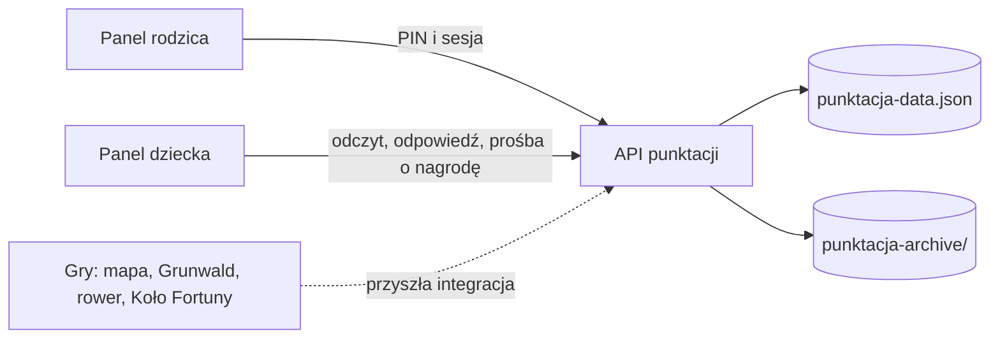

# System Rafcia — mapa

Aktywny interfejs to `public/punktacja/index.html`, `app.js` i `style.css`, dostępne ze strony głównej `/` oraz `/punktacja`. Serwer i reguły punktacji znajdują się obecnie w sekcji System Punktacji w `server.js`. Rodzic konfiguruje obowiązki, bonusy, misje i nagrody oraz ocenia dzień. Dziecko ogląda postęp, odpowiada na pytanie dnia i prosi o nagrodę. Oba widoki korzystają z jednego pliku danych; baza danych nie jest jeszcze potrzebna do działania lokalnego.

PIN jest przechowywany jako skrót scrypt. Odpowiedzi API nie zawierają `parentPin`; `pinSet` mówi interfejsowi, czy wyświetlić konfigurację. Starszy jawny PIN jest migrowany po poprawnym logowaniu. Sesja rodzica jest w pamięci procesu, wygasa po 15 minutach bezczynności i kończy się po przejściu do widoku dziecka; restart serwera też wymaga ponownego logowania. Dane JSON są lokalne i nie wspierają wielu niezależnych rodzin ani równoczesnych instancji serwera.

Pozostałe gry mają własne strony i zasoby. Obecnie nie przekazują wyników do Rafcia. Przyszły kontrakt integracji powinien przyjmować wynik gry na serwerze, weryfikować limit prób i naliczać punkty według ustawień rodzica. Nie przyjmować liczby punktów jako zaufanej wartości od przeglądarki.

Katalog `public/punktacja/assets/` zawiera zarówno używane obrazy, jak i starsze kopie kodu (`app.js`, `index.html`, style). Nie traktować tych kopii jako aktywnego interfejsu.

## Jak działa gra

Rafcio to domowa gra motywacyjna. Rodzic ustala, za co dziecko zdobywa punkty i na jakie nagrody może je wymieniać. Dziecko widzi swoje zadania, wynik i postęp na mapie wyprawy.

1. **Przygotowanie.** Rodzic ustawia PIN, dodaje obowiązki, aktywności dodatkowe, misje i nagrody. Grę można rozpocząć od razu lub zaplanować. Data końcowa jest opcjonalna.
2. **Rozliczenie dnia.** Rodzic wybiera dzień i oznacza wykonanie. Dziecko może przesłać odpowiedź na pytanie dnia, a rodzic oznacza je jako zaliczone lub niezaliczone.
3. **Odbiór nagrody.** Dziecko prosi o dostępną nagrodę. Punkty są potrącane po zatwierdzeniu przez rodzica. Oczekująca prośba nie rezerwuje punktów. Serwer ponownie sprawdza saldo przy zatwierdzaniu.
4. **Kolejna gra.** Przy rozpoczęciu nowej gry rodzic może zarchiwizować obecną. Wczytanie archiwum zastępuje bieżący stan.

### Saldo widoczne w aplikacji

| Zdarzenie | Wpływ na saldo |
| --- | --- |
| Obowiązek wykonany | Dodaje wartość obowiązku |
| Obowiązek oznaczony jako niewykonany | Odejmuje tę samą wartość |
| Obowiązek bez oceny | 0 pkt |
| Aktywność dodatkowa | Dodaje swoją wartość po zaliczeniu danego dnia |
| Misja czasowa | Dodaje swoją wartość jednokrotnie po zaliczeniu |
| Pytanie dnia | Dodaje skonfigurowaną wartość po zaliczeniu przez rodzica, domyślnie 10 pkt. Niezaliczenie daje 0 pkt |
| Ręczny bonus lub konsekwencja | Bonus dodaje punkty, konsekwencja je odejmuje |
| Nagroda | Odejmuje koszt dopiero po zatwierdzeniu |

Przykład. Obowiązek za 10 pkt, aktywność dodatkowa za 5 pkt i zaliczone pytanie za 10 pkt dają w aplikacji 25 pkt. Po zatwierdzeniu nagrody za 15 pkt ekran pokaże 10 pkt. Po lokalnej naprawie RF-03 serwer również rozpoznaje 25 pkt przed zatwierdzeniem i 10 pkt po nim. Wcześniejsze pomijanie pytania (wynik serwera 15 pkt przed zatwierdzeniem) pozostaje opisane w historii Git.

### Postęp wyprawy

Wyprawa pokazuje dwa dodatkowe rodzaje postępu. Szczyty odblokowują się za sumę zdobytych dodatnich punktów, bez potrąceń za nagrody i konsekwencje. Po lokalnej naprawie RF-04 uwzględniają także daty z samym zaliczonym pytaniem; dzień wspólny dla pytań i obowiązków jest rozliczany raz. Sprzęt odblokowuje się według najdłuższej serii dni z kompletem obowiązków. Idealny dzień wymaga co najmniej jednego aktywnego obowiązku i wykonania wszystkich aktywnych obowiązków. Dzisiejszy dzień w trakcie rozliczania nie przerywa bieżącej serii, chyba że rodzic oznaczy obowiązek jako niewykonany.

Znane ograniczenia punktacji: [KNOWN_ISSUES.md](KNOWN_ISSUES.md).
