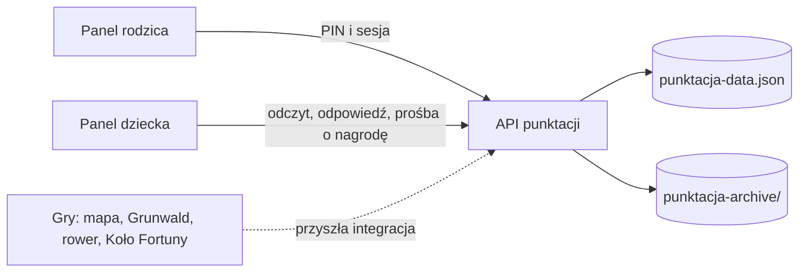

# System Rafcia — mapa

Aktywny interfejs to `public/punktacja/index.html`, `app.js` i `style.css`, dostępne ze strony głównej `/` oraz `/punktacja`. Serwer i reguły punktacji znajdują się obecnie w sekcji System Punktacji w `server.js`. Rodzic konfiguruje obowiązki, bonusy, misje i nagrody oraz ocenia dzień. Dziecko ogląda postęp, odpowiada na pytanie dnia i prosi o nagrodę. Oba widoki korzystają z jednego pliku danych; baza danych nie jest jeszcze potrzebna do działania lokalnego.

PIN jest przechowywany jako skrót scrypt. Odpowiedzi API nie zawierają `parentPin`; `pinSet` mówi interfejsowi, czy wyświetlić konfigurację. Starszy jawny PIN jest migrowany po poprawnym logowaniu. Sesja rodzica jest w pamięci procesu, wygasa po 15 minutach bezczynności i kończy się po przejściu do widoku dziecka; restart serwera też wymaga ponownego logowania. Dane JSON są lokalne i nie wspierają wielu niezależnych rodzin ani równoczesnych instancji serwera.

Pozostałe gry mają własne strony i zasoby. Obecnie nie przekazują wyników do Rafcia. Przyszły kontrakt integracji powinien przyjmować wynik gry na serwerze, weryfikować limit prób i naliczać punkty według ustawień rodzica. Nie przyjmować liczby punktów jako zaufanej wartości od przeglądarki.

Katalog `public/punktacja/assets/` zawiera zarówno używane obrazy, jak i starsze kopie kodu (`app.js`, `index.html`, style). Nie traktować tych kopii jako aktywnego interfejsu.
